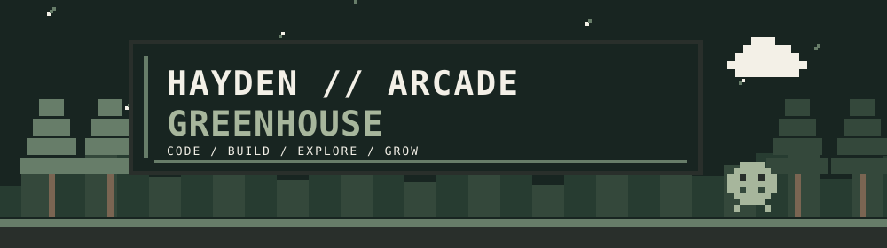

<!-- HAYDEN // ARCADE GREENHOUSE · pixel-art developer profile -->

<strong>Hayden Gamble</strong> · Computer Science & Engineering · University of Iowa

Software engineering / applied ML / embedded systems / creative problem-solving

  <a href="https://haydencg93.github.io/">Portfolio</a> ·
  <a href="https://haydencg93.github.io/catalogd/">Catalogd live demo</a> ·
  <a href="https://www.linkedin.com/in/haydencg93/">LinkedIn</a>

### `> PLAYER_01 / ABOUT`

I'm Hayden, a Computer Science and Engineering student at the University of Iowa. I enjoy designing software that is useful, thoughtfully built, and interesting under the hood—from full-stack web applications to embedded systems and machine-learning experiments.

### `> FEATURED_QUEST / CATALOGD`

**[Catalogd](https://haydencg93.github.io/catalogd/)** — a serverless home for discovering, tracking, logging, and ranking movies, shows, books, and music.

- **Product:** A unified media experience powered by TMDB, OpenLibrary, and Last.fm APIs.
- **Architecture:** Component-driven vanilla JavaScript frontend with a Supabase backend.
- **ML:** Personalized vector-based recommendations using Qdrant and Transformers.js.

`JavaScript` · `Supabase` · `REST APIs` · `Qdrant` · `Transformers.js`

**[Play the live demo ↗](https://haydencg93.github.io/catalogd/)** · **[View source ↗](https://github.com/haydencg93/catalogd)**

### `> EXPERIENCE / COMPLETED_LEVELS`

**Software Development Intern — VT Industries** · Summer 2025  
Worked on production-level software solutions in a professional engineering environment.

**Competitive programming**  
Competitor in three national computer science competitions, focusing on algorithms, speed, and problem solving.

**University of Iowa**  
Coursework includes software security, computer architecture, embedded systems, algorithms, networks, databases, and software design.

### `> INVENTORY / TECH STACK`

| Software and systems | Tools and platforms |
| :-- | :-- |
| Python · Java · C++ · JavaScript · C# | Git · GitHub · VS Code · Visual Studio |
| SQL · Embedded C · Verilog · Embedded Assembly | .NET · SFML · GitHub Pages |

### `> SELECT LEVEL / PROJECTS`

| Project | What it explores |
| :-- | :-- |
| **[Catalogd](https://github.com/haydencg93/catalogd)** | Full-stack media discovery and personalized recommendations |
| **[Portfolio](https://github.com/haydencg93/haydencg93.github.io)** | Personal website and technical work |
| **[Projects for Resume](https://github.com/haydencg93/projectsForResume)** | Selected coding projects and coursework |
| **[Catalogd Beta](https://github.com/haydencg93/catalogd-beta)** | Development and experiments for Catalogd |

### `> WORLD_MAP / CONTRIBUTION GARDEN`

Each tile is a day. More contribution activity grows a larger plant. The map updates using GitHub Actions.

### `> NPCS / MISO + MOCHI`

**Miso** is the tiny frog exploring the greenhouse; **Mochi** is the drifting cloud. Both live inside our animated pixel-art illustrations. Animations respect reduced-motion preferences.

